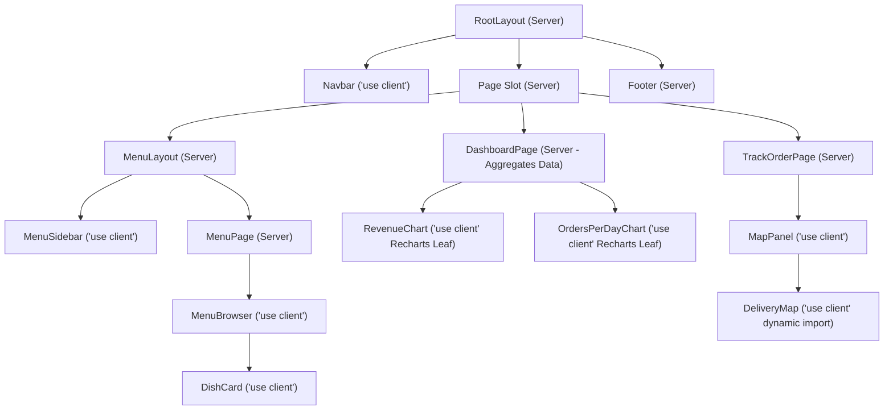

# Component and Trust Boundaries (BOUNDARY.md)

## 1. Server Component vs. Client Component Placement

In adherence to Next.js App Router best practices, **Server Components are the default**. `"use client"` is isolated strictly at the smallest practical interactive leaf boundaries.

### Why Specific Components are Client Leaves
1. **`Navbar.tsx` (`"use client"`)**: Reads `usePathname()` to display active navigation highlights, accesses `useCart()` for real-time shopping badge counts, and reads `useAuth()` to present the current demo user profile.
2. **`MenuSidebar.tsx` (`"use client"`)**: Reads `useSearchParams()` to highlight the currently filtered category and provide immediate link responses.
3. **`MenuBrowser.tsx` (`"use client"`)**: Manages the local search input buffer, coordinates debounced URL transitions, and executes SWR cache queries.
4. **`DishCard.tsx` (`"use client"`)**: Contains an interactive "Add to Cart" button with `e.stopPropagation()` and brief visual feedback ("Added!") upon insertion.
5. **`AddToCartControl.tsx` (`"use client"`)**: Interactive quantity stepper maintaining local numeric state before dispatching to `CartContext`.
6. **`RevenueChart.tsx` and `OrdersPerDayChart.tsx` (`"use client"`)**: Recharts relies on DOM APIs, SVG measuring, canvas rendering, and browser window dimensions. They are kept as terminal leaf components that receive small, pre-computed numeric payloads from `DashboardPage`.
7. **`DeliveryMap.tsx` (`"use client"`)**: Leaflet interacts directly with `window`, HTML canvas, and CSS DOM elements. Loaded dynamically with `ssr: false` inside `MapPanel.tsx`.

---

## 2. Trust and Data Boundaries

### Browser to Mock Service Boundary
- **Prices and Totals**: The browser is **never trusted** to determine dish prices, subtotals, or order totals. When `createOrder()` is called, the mock service ignores any client price properties, pulls authentic unit prices from `FIXTURE_DISHES`, and calculates the authoritative integer ETB total.
- **Cart Contents**: The cart in localStorage stores only `dishId` and user-requested `quantity`. Tampering with localStorage prices in browser developer tools has zero effect on the final order invoice.
- **Idempotency**: Submitting checkout sends a client-generated UUID (`idempotencyKey`). The service caches processed keys; double-clicks or duplicate requests return the original order rather than duplicating records.

### Session and Role Boundaries
- **Ownership Verification**: Order lookups in `getOrderById(id, currentUser)` verify that `order.userId === currentUser.id` (or `currentUser.role === 'staff'`). Changing an order ID in the URL bar to an order belonging to another customer returns an unauthorized refusal.
- **Staff Access**: Mutating kitchen progress via `updateKitchenStatus()` strictly requires `currentUser.role === 'staff'`.

---

## 3. Local Demo Scope and Limitations

1. **Storage Reset on Reload**: All simulated orders created during a browser session are stored in client memory. A full browser reload restores default fixture data.
2. **Not Production Access Control**: Because all authentication logic and role guards run inside client-side JavaScript, they are interface guards designed to demonstrate correct UX states, not security guarantees against client-side tampering.
